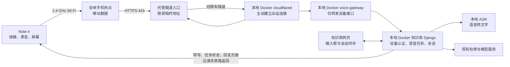

# ZECTRIX Note 4 知识库语音终端实施方案

日期：2026-10-27。状态：完成资料核查与本机只读检查，尚未开发、部署或刷写。

用户已确定：安卓手机；需要外出通过手机流量连接家里的知识库；按住说话，松手自动发送；设备显示识别文字与 AI 回复。

本轮修订：用户目前没有公网 IP，服务端统一运行在本地电脑 Docker 中。取消自建公网服务器、frps 和自有域名作为首版前置要求；外出访问先通过本地 Docker 中的出站隧道联调，手机继续提供移动网络。

设备管理修订：网页使用“添加设备”，以设备列表支持持续新增设备；Note 4 是首个接入型号，不设置账号只能接入一台设备的限制。默认会话和知识库范围是每台设备可修改的发送设置。

## 1. 目标与已核实条件

把 Note 4 做成现有知识库的专用语音终端：保留同一用户、同一会话、同一知识库范围和同一套操作确认规则。手机负责提供网络，知识库电脑负责转写、检索和模型调用。

| 项目 | 本次证据 | 尚需验证 |
| --- | --- | --- |
| USB 数据连接 | Windows 存在 COM7，VID_303A / PID_1001，同时存在 USB JTAG/serial debug unit | 该串口是否确为这块 Note 4，板卡批次、芯片及 Flash 信息 |
| 开发环境 | 本机 E:/Espressif 存在 ESP-IDF v6.0.2、配套 Python、esptool v5.4.0 | 参考工程在这个版本下的实际编译、运行结果 |
| 知识库 | Compose 的 web、worker、scheduler、PostgreSQL、Redis、Qdrant 均报告 running / healthy；web 监听 127.0.0.1:8800 | 当前模型真实回答、后续 ASR 性能与远程连接实测 |
| 聊天能力 | 已有 POST /api/v1/planner/chat/ 与 GET /api/v1/planner/conversations/{id}/ | 设备接入、语音转写、事件同步与请求去重需要新增 |

官方 V1.0 黑白 Note 4 开发套件具有 ESP32-S3、16 MB Flash、8 MB PSRAM、400×300 墨水屏、ES8311 音频、2.4 GHz Wi-Fi 与实体按键；这足以支持本方案。上述规格来自官方资料，并非本次对用户实物完成的芯片检测。[官方开发指南](https://wiki.zectrix.com/zh/software/note4-development-guide)

当前 C-to-C 连接已经能枚举 USB 数据设备；后续作为供电、备份、刷写和调试通道使用。外出联网使用手机热点。无需让雷电接口承担特殊协议。

## 2. 推荐结构：本地 Docker + 出站隧道 + 安卓移动网络



这是一条逻辑链路。设备连接安卓热点，通过手机移动网络访问隧道地址；本地 Docker 里的连接组件主动建立隧道，把请求转给同一台电脑中的知识库。家庭网络不需要公网 IP 或端口映射，手机无须安装专用 App，也不依赖安卓把 VPN 转发给热点设备。

联调候选采用 Cloudflare Quick Tunnel：无需账号或自有域名，可获得临时 HTTPS 地址；连接从内网发起，因此源站无须公网 IP。此处仍依赖第三方隧道服务，并非仅靠手机流量就能直接穿过家庭内网。[隧道原理](https://developers.cloudflare.com/tunnel/concepts/)

临时地址会随隧道重建而变化，且没有在线率保证，只适合开发联调；首版长期使用前需落实固定入口。先用你的实际手机流量测试访问与音频上传，不能预设该服务在当前网络稳定。若不通，替换为经实测可达的托管隧道，后端和固件协议不变。[Quick Tunnels 限制](https://developers.cloudflare.com/tunnel/get-started/quick-tunnels/)

两种场景需明确区分：

- **电脑和开发板都连接同一手机热点：** 可以先在热点内直连电脑，无需隧道，但要实测手机是否允许客户端互访；现有 127.0.0.1:8800 绑定也不能直接供开发板访问。优先只为设备网关开放受限端口。
- **电脑留在家里，开发板随手机外出：** 延续用户已确认的目标，必须增加出站隧道或私有组网。单独开启手机热点不会让家庭内网自动可达。

部署分工：

- 本地 Docker：知识库、voice-worker、本地 ASR、voice-gateway 与 cloudflared 均运行在这里；通过容器网络访问 web:8000，不把容器内 localhost 误认为宿主机。
- voice-worker：语音任务使用独立队列，避免被长时间资料解析任务占满。
- voice-gateway：只向隧道转发设备接口，管理页面和现有完整聊天接口不接入这条公网通道。
- 安卓手机：开启 2.4 GHz 热点，设置固定名称及密码，关闭会影响设备使用的热点自动关闭选项。具体菜单按手机型号确认。
- Note 4：保存热点与远程入口地址，执行录音、上传、轮询和显示。

**可用性前提：本地电脑、Docker、知识库、隧道和家中网络需保持运行。** 电脑睡眠后，外出请求不能得到知识库回答。第一版保留待重试录音，隧道不承担转写、检索或模型计算。

托管隧道会终止 HTTPS，因此服务提供方理论上可接触经过它的音频和文字；不能把它说成只有两个终端能解密的连接。ASR 在本地处理，但现有模型服务仍按知识库当前配置接收文本上下文。

## 3. 最终使用流程

1. 在知识库网页“设备管理”中点击“添加设备”，添加 Note 4，设置名称、默认会话及知识库范围。默认创建与设备名称对应的专用会话，网页可以随时打开；以后可从同一入口继续添加其他设备，分别管理发送设置。
2. 开启安卓热点。设备联网后显示会话名称、连接状态、最近回复时间。
3. 按下正面按钮：立即初始化采音，准备就绪后用 LED / 短提示音反馈。以提示为开口信号，避免把开机或唤醒时间误当成已录音。
4. 持续按住说话。设备在 PSRAM 保存录音；录音任务不等待屏幕刷新或 Wi-Fi 重连。
5. 松手：封装音频并上传。屏幕先显示“正在识别”，得到最终转写后显示“我说：……”及“正在发送”。
6. 服务端把转写提交到该设备当前设置的会话，调用现有知识库检索和模型。网页同步显示同一条用户消息，并标明来源设备。
7. AI 回复持久化后，设备取得回复分页并显示第一页；网页出现同一条回复。
8. 上下键翻页；正面短按在“我说的内容 / AI 回复”间切换。再次长按开始下一轮。

第一版采用“松手后显示完整转写”。若后续需要边说边显示文字，再增加流式转写；录音时逐字刷屏既增加工作量，也不适合墨水屏。

## 4. 输入框同步：呈现给网页，但由服务端负责唯一提交

用户所说的“进入输入框”落实为网页内的语音接入功能。每台已添加设备都可选择服务端目标会话；该选择属于可修改的发送设置，与 Windows 当前光标位置无关。

- 网页打开设备所选会话且输入框为空时，收到 transcript.final 事件，把识别文字放入现有 composer 输入框，并按实际设备名称显示“来自〈设备名称〉，正在发送”。事件同时携带 device_id 与 turn_id，区分不同设备。
- 服务端自行完成自动发送；网页只同步结果，不能因为收到事件再次调用聊天发送接口。
- 提交成功后，只有输入框仍属于该 turn_id 且草稿版本未变化，才清除这段语音文字。用户新输入的内容必须保留。
- 输入框已有手工草稿时，保留草稿；语音以独立的“Note 4 已发送”提示及消息气泡呈现。
- 网页处在其他会话时，显示目标会话收到新语音的提示，不替用户切换会话、不把文字写进其他会话。
- 浏览器关闭时，设备仍可完成问答；网页下次打开从服务端恢复历史。已提交的旧语音不能重新填回输入框。
- 多标签页可以同步显示，任何标签页都不承担设备消息的再次提交。

浏览器同步第一版采用带游标的短轮询：页面可见且存在已添加设备时约 1 秒一次，以一次请求批量获取当前用户设备事件；隐藏时减频，恢复可见时立即补拉。当前项目使用 WSGI/Gunicorn，短轮询能避免为首版增加 WebSocket/ASGI 部署。后续确有需要时再升级推送。

当前网页发送逻辑位于 [kb-assistant.js](../apps/webui/static/webui/kb-assistant.js)，使用 composer、conversationId 与 scopeCodes；接入时增加受控事件处理，不能直接复用 send() 再发一次。

## 5. 固件设计

### 5.1 基础工程与板级处理

以官方 [zectrix-note4-epd-demo](https://github.com/itopinion/zectrix-note4-epd-demo) 的板级层、音频自检和显示驱动为基础，记录采用的 commit 及依赖版本。官方工程提供硬件能力示例，但还不是本方案的语音终端。

先在本机现有 ESP-IDF 6.0.2 编译和验证；如发现驱动或波形兼容问题，在独立目录安装并固定兼容的 5.4/5.5 环境，不覆盖现有工具链。验收包附 sdkconfig、依赖锁、分区表与构建说明。

确认实物匹配 V1.0 后采用官方映射：正面 GPIO0、上键 GPIO39、下键 GPIO18；启动阶段正确保持 GPIO17 电源锁存。GPIO0 同时参与启动配置，必须测试按键唤醒、复位与下载模式的相互影响，不能只测 USB 供电下的运行。[官方硬件映射](https://wiki.zectrix.com/zh/software/note4-development-guide)

任务分离：按键扫描、音频采集、网络上传、屏幕更新分别运行。官方 EPD 刷新接口是同步等待 BUSY 的调用，屏幕刷新不可放在音频采集路径里。[显示接口说明](https://raw.githubusercontent.com/itopinion/zectrix-note4-epd-demo/main/docs/EPD_API.md)

### 5.2 采音与操作规则

| 项目 | 第一版规则 |
| --- | --- |
| 录音格式 | 16 kHz、单声道、PCM signed 16-bit little-endian；上传为 WAV |
| 内存预算 | 32,000 字节/秒，60 秒约 1.92 MB；启动时预分配 PSRAM，另核算 TLS、页面及任务栈余量 |
| 按键去抖 | 初值 30 ms，实物调整 |
| 长短按 | 按下即准备/缓存音频，持有约 200 ms 确认为语音动作；短按丢弃缓存并执行页面切换 |
| 最长录音 | 初值 60 秒，达到上限停止采集并提示；本次松手后提交，不因仍按住而启动第二轮 |
| 取消 | 录音时长按上键约 1 秒取消，停止采集且不提交 |
| 空音频 | 服务端 VAD + 识别结果检查；静音不进入聊天。低可信结果显示“未听清，请重说” |
| 处理中再按 | 第一版每设备只允许一轮，提示“正在回答”；不叠加录音与排队 |
| 提示音 | 提示音播放完成后再开始有效录音，避免把提示音当作用户语音 |

不要只依赖音量阈值判断是否有人说话，也不要让 ASR 在静音时生成的幻觉文本自动发送。识别错误不能靠未经用户授权的 LLM“润色”成另一个意思；保留原始最终转写。专业名词热词在识别层配置。

### 5.3 断线与状态

状态主线：READY → RECORDING → UPLOADING → TRANSCRIBING → SUBMITTED → THINKING → ANSWER_READY。

额外状态：OFFLINE、RETRYABLE_ERROR、UNCERTAIN、CANCELED、EXPIRED。每个状态都带 turn_id，收到旧轮次事件不得覆盖新轮次画面。

- Wi-Fi 未连上时仍可录一条，保留在 PSRAM；显示“未联网，录音待发送”。
- 2 分钟以内、设备发送设置未变化且已明确选择自动发送的录音可在重连后自动续传；超过 2 分钟停止自动提交，由短按确认重试或取消。第一版每台设备只保留一条。
- 尚未上传的录音只在内存中，断电会丢失；屏幕说明“待发送录音未保存”。不承诺离线永久保存。
- 已上传后把 turn_id、最后状态、发送设置版本写入 NVS。设备重启先查询该轮状态，不能重建一条新提问。
- 超时后先查询原 turn_id。明确失败才允许重试；状态不明显示“处理中，正在确认”，避免重复发送。
- 第一版上传失败重新发送同一个完整文件；无需先做分块续传。后端在完整文件校验成功后才启动 ASR。

### 5.4 功耗

第一版 USB 供电时保持就绪；电池模式先保证按键响应，再通过测量决定空闲休眠策略。只有任务终态、无待上传音频、无按键持续按下时，才允许进入深睡眠。

唤醒后先恢复采音能力，后恢复网络。若使用深睡眠导致首句起音明显丢失，应采用更轻的待机策略或“提示后开口”，不能承诺从睡眠状态零延迟收音。等待 AI 时保持轮询；拿到回复后再休眠。墨水屏保留旧画面不等于设备在线，必须显示回复时间和最后连接状态。

## 6. 中文与回复显示

推荐由家中服务端完成中文排版，设备接收可直接显示的黑白位图。这样不要求首版固件塞入完整中文字库，也便于统一处理长回复。

- 画布：400×300 横向；文字建议 18–22 像素，初始约每行 18–21 个汉字，最终以真实字形及边距验收。
- 页首：会话短名 / 状态；正文：转写或 AI 回复；页脚：页码、时间、连接状态。
- 默认显示回复原文的分页，保留列表、关键数值、检索范围不足和待确认提示，不把模型生成的摘要替换成完整答复。
- 表格转换成逐项文字，代码块保留换行，来源编号保留；复杂图表、附件和操作卡提示“请在网页查看”。
- 超长回答按页生成和缓存，设备按需获取，不需要一次下载全部页；单页内存固定。
- 页面格式：row-major、MSB first、1 bpp、0 黑 / 1 白，400×300 正好 15,000 字节；元数据包含宽高、格式、长度、SHA-256 和内容版本。
- 设备下载完整并通过长度及哈希校验后才刷新；失败保留上一页，显示网络错误。
- 本地只内置常见状态所需的小字库，离线也能显示录音、待发送及重试等状态。
- 第一版主要在录音状态变化、转写完成、回复完成、手动翻页时刷新；不用逐 token 刷新。局刷前建立全刷基底，并按真机残影情况周期性全刷。

位图约定与刷新前置条件来自 [官方 EPD API](https://raw.githubusercontent.com/itopinion/zectrix-note4-epd-demo/main/docs/EPD_API.md)。服务端需要安装并固定授权清晰的中文字体，验收中文、英文、数字、标点、罕见字和无对应字形的替代显示。

## 7. 知识库后端与接口契约

以下接口、模型及文件均为**待实现设计**，不是当前已有能力。

### 7.1 新增模块与数据

新增 apps/voice，主要实体：

| 实体 | 必要信息 |
| --- | --- |
| VoiceDevice | 独立 device_id、所属用户、设备名称、设备类型、协议版本、能力清单、凭据摘要、启用/停用/移除状态、最后在线时间 |
| DeviceRouteConfig | 所属设备、目标会话 ID、知识库范围、设置版本 config_version、是否允许自动发送 |
| VoiceTurn | UUID、设备、发送设置快照、音频哈希、状态、转写、用户/助手消息 ID、失败阶段、重试次数 |
| VoiceEvent | 用户/设备/轮次、单调事件序号、事件类型、最小必要载荷 |
| ChatTurn / 会话执行租约 | 网页与设备共用的会话串行化、处理阶段、执行所有权、心跳与恢复记录 |

VoiceTurn 的唯一约束为 (device_id, turn_id)。同一 ID 相同音频返回原任务；同一 ID 不同音频返回 409。事件和回复页面按用户与设备授权，不能仅凭可猜测的整数 ID 下载。

用户与设备为一对多关系，DeviceRouteConfig 按设备保存，不设置“每用户唯一设备”约束。设备列表支持添加、重命名、修改发送设置、启用/停用和移除；添加第二台设备不覆盖第一台设置或凭据。移除设备立即吊销其访问凭据，保留已有会话与审计记录。

不同设备可各用一个会话，也可主动选择同一会话。每台设备最多一轮在途请求；同一会话的多设备请求按序执行，不同会话可在 worker 总并发上限内独立处理。每份回复按发起请求的 device_id 和 turn_id 返回，默认不广播给其他设备；设备屏幕只接收其权限和显示能力允许的内容。

后续设备通过 device_type、protocol_version 与 capabilities 声明录音、显示、分页等能力，网关及会话服务复用通用协议。首版实现 Note 4 适配；其他型号仍须完成对应的采音与显示适配，不能把“可继续添加”解释为任意硬件已经即插即用。

### 7.2 设备接口

所有设备接口位于 /api/v1/voice/device/ 下，使用 HTTPS + Authorization: Bearer <设备专用凭据>。

| 方法与相对路径 | 行为 |
| --- | --- |
| GET /config/ | 根据设备凭据获取本设备的 device_id、发送设置版本、录音上限与协议能力 |
| POST /turns/ | 上传 WAV，携带 turn_id、config_version、audio_sha256；设备身份由凭据确定，校验成功后持久接收，返回 202 和状态查询地址 |
| GET /turns/{uuid}/ | 获取阶段、转写、错误及消息 ID；字段按阶段逐步出现 |
| GET /turns/{uuid}/pages/?view=transcript 或 answer | 获取分页数、内容版本及页面清单 |
| GET /turns/{uuid}/pages/{page_id}/ | 获取本轮已授权页面的 15,000 字节位图 |
| POST /turns/{uuid}/retry/ | 同一轮失败恢复，不重新创建用户消息；按失败阶段决定允许操作 |
| POST /heartbeat/ | 空闲低频上报固件版本、电量与最后完成轮次，不上传录音内容 |

协议初值：请求体上限 3 MiB；只接受支持的 WAV 编码和最多 60 秒音频，同时检查实际采样数据长度，不能只相信文件头；上传接收完成后才返回 accepted。设备约 1 秒查一次活动任务，慢请求退避，空闲时不持续轮询聊天。

示例状态响应：

```json
{
  "protocol_version": 1,
  "device_id": "dev_note4_01",
  "turn_id": "3d7b3f9a-4f46-48b4-98f7-1e2bf78a3a80",
  "config_version": 3,
  "conversation_id": 123,
  "state": "answer_ready",
  "transcript": "查一下上周设备验收记录。",
  "user_message_id": 456,
  "assistant_message_id": 457,
  "answer_page_count": 3,
  "content_version": 1
}
```

### 7.3 网页管理与事件接口

新增 /api/v1/voice/devices/ 设备列表与添加接口、/api/v1/voice/devices/{device_id}/ 设备详情管理接口，以及 /api/v1/voice/events/?after=<cursor> 事件查询。继续使用网页登录和 CSRF 机制，完成添加设备、修改发送设置、重命名、停用、移除、凭据轮换、查看状态和补拉事件。所有管理动作分别核验设备所属用户；公网设备代理不转发这些管理接口。

事件至少包括 transcript.final、turn.submitted、answer.ready、turn.failed、device.added、device.config_changed、device.disabled、device.removed。设备事件带 device_id，轮次事件另带 turn_id 与 conversation_id。返回 next_cursor；事件过期或游标失效时返回需要重新同步的标记，网页恢复会话历史与设备当前任务状态，不能静默漏掉消息。

### 7.4 复用现有聊天的具体改造

已有 ChatView 接收 message、conversation_id、library_codes，成功返回 conversation_id、user_message_id、assistant_message_id、content 等；服务入口为 apps/planner/services.py 的 reply_to_message()。

不能让设备持有知识库用户名和密码，再直接循环调用现有 ChatView：它目前先创建用户消息后调用模型，没有设备级请求幂等协议。正确改造为：

1. 把“记录用户消息 / 执行检索与模型 / 保存回复与提案”拆成可以用持久 turn 继续执行的阶段，网页原接口保留兼容行为。
2. 语音任务转写后创建一次用户消息并记录其 ID，后续恢复复用这条消息。网页和语音共用同一会话执行租约，防止同时问答导致上下文交错。
3. 数据库锁仅用于短事务；不在调用 ASR 或模型期间长时间持有行锁。用租约、心跳和执行代次阻止过期 worker 回写。
4. 回复、提案与完成状态以明确的事务边界保存；提案使用 turn 关联的唯一标识去重，已经保存的工具结果从检查点恢复。
5. 新语音工作队列由 PostgreSQL 保存最终状态，Redis/Celery 负责调度；任务提交采用 outbox 或可扫描补投的 queued 状态，避免“数据库有任务但消息未投递”。
6. worker 崩溃后，若能确认请求尚未调用模型则安全恢复；若模型或工具调用结果不明，标记 uncertain 并先核对已有消息、提案和阶段，不能盲目再跑一遍。外部模型调用不宣称严格恰好一次计费。
7. ASR 失败只重试 ASR；模型失败保留转写及用户消息，只重试回答；页面渲染失败只重试渲染。

发送设置快照在录音开始时确定，上传时校验 config_version。在本设备有活动轮次时拒绝修改其目标会话；其他设备的设置仍可独立修改。会话被删除、设备停用/移除或权限失效时停止提交，要求恢复权限或重新选择会话。

**知识库范围补丁：** 当前 build_context_report() 在显式范围无可用库时会退回全部可读库；设备不应悄悄扩大范围。语音入口明确区分 all_authorized 与 selected 两种模式，在转写提交和实际检索时重新核验。selected 中任一目标失效时停止该轮并提示重新选择；共用检索服务增加 strict_scope 选项，严格模式不得回落全库。不能用 library_codes: [] 表示全库，当前接口将其判为 400。

**操作确认：** 语音普通提问自动提交；搜索与回答沿用现有只读执行规则。删除资料、清库、写入等请求继续生成待确认卡片，设备显示“需要在网页确认”，不把说一句“确认”或按钮松手解释为现有多步确认凭据。

## 8. ASR 选择与运行预算

默认先部署本地 ASR 适配服务，候选为 [faster-whisper](https://github.com/SYSTRAN/faster-whisper)；使用中文样本比较模型大小、CPU int8 与可用 GPU 的结果后固定配置。它支持 CPU/GPU 与量化，但仓库性能不能直接当成本机的速度承诺。

ASR 适配层保持独立，之后如需更低延迟可以切换已有的远程中文 ASR 服务。当前未核实用户是否有可用 ASR 服务或相应凭据，不能把知识库现有文本模型当成天然支持语音的模型。

首版先用 WAV 完整上传；60 秒约 1.92 MB，10 秒约 320 KB，协议开销另计。流量或延迟不满足要求时再加入 Opus，不作为硬件闭环的前置依赖。

暂定验收目标为 10 秒语音松手后，上传加转写在网络正常时 P95 不超过 8 秒；AI 回复时间单独统计，取决于现有模型与检索负载。此为待测目标，不是当前实测结果。阶段耗时分别记录，超时显示具体阶段。

原始录音是可过期临时数据，不自动进入知识库、不成为不可修改原件。第一版只在转写完成后的短期恢复窗口保留，默认最长 1 小时清除；调试保存需主动开启。文本与聊天消息按现有会话保留规则处理。上传临时区需容量配额与定时清理。

## 9. 远程部署与设备凭据

### 9.1 本地 Docker 部署模板

以下为待实现的 Compose 附加文件示意（deploy/docker-compose.voice.yml），通过根 Compose 统一启动，不替换现有部署入口。设备认证和路径限制完成前，只使用独立测试服务验证隧道可达性，不把现有整个知识库接入隧道。本次只修改方案，没有创建或启动这些服务。

```yaml
services:
  voice-gateway:
    image: nginx:stable-alpine
    restart: unless-stopped
    volumes:
      - ./deploy/voice-gateway/nginx.conf:/etc/nginx/conf.d/default.conf:ro
    depends_on:
      web:
        condition: service_healthy

  voice-tunnel:
    image: cloudflare/cloudflared:latest
    restart: unless-stopped
    command: ["tunnel", "--no-autoupdate", "--url", "http://voice-gateway:8080"]
    depends_on:
      - voice-gateway
```

以上浮动镜像标签仅用于模板；实施时拉取并验证后锁定版本或 digest。两个新增容器加入现有默认网络，均不发布宿主端口；web 保持原有本机绑定。volume 路径按下面命令中第一个 Compose 文件所在的仓库根目录解析。

网关配置示意（deploy/voice-gateway/nginx.conf）：

```nginx
server {
    listen 8080;
    server_name _;
    client_max_body_size 3m;

    location ^~ /api/v1/voice/device/ {
        proxy_pass http://web:8000;
        proxy_set_header Host localhost;
        proxy_set_header Authorization $http_authorization;
        proxy_set_header X-Forwarded-Proto https;
        proxy_read_timeout 30s;
        add_header Cache-Control "no-store" always;
    }

    location / {
        return 404;
    }
}
```

proxy_pass 不附带 URI，保留原设备接口路径。网关固定发给 Django 的 Host 为 localhost，避免临时隧道重启后要不断修改 ALLOWED_HOSTS，也避免允许任意 Host。该网关只用于 HTTPS 隧道入口；若以后兼作同热点直连，需另设本地 TLS 与可信代理头策略，不把 HTTP 当作 HTTPS。

实施完成后从项目根执行：

```powershell
docker compose -f docker-compose.yml -f deploy/docker-compose.voice.yml config --quiet
docker compose -f docker-compose.yml -f deploy/docker-compose.voice.yml up -d voice-gateway voice-tunnel
docker compose -f docker-compose.yml -f deploy/docker-compose.voice.yml logs --tail 40 voice-tunnel
```

读取日志中实际生成的 HTTPS 地址，经 USB 或设备配置页写入 Note 4 的 server_url。临时地址只作为开发配置；隧道重建后需重新核对并更新。不能把一次随机地址写死进发布固件。设备保存地址与凭据分开，地址改变不重建设备身份。

Quick Tunnel 不支持 SSE，因此本方案的 HTTP 上传与短轮询保持不变。它的交互式邮箱认证不适合板子，设备接口采用自己的 Bearer 凭据；临时网址不属于密码。上线前验证无凭据请求被拒绝、非设备路径返回 404、响应不缓存。[官方联调说明](https://developers.cloudflare.com/tunnel/get-started/quick-tunnels/)

设备端验证证书链与域名，先用 RTC / 网络校时获得有效时间，不通过关闭 TLS 校验解决证书问题。网页管理继续走本机原有入口。

长期使用有两个升级方向，均不要求家中公网 IP：使用固定域名的托管隧道，或手机与电脑建立私有网络并增加明确的设备中转。后者需要单独验证热点路由或开发手机中转程序，不能假设手机安装 VPN 后开发板就自动可达。当前先完成本地 Docker 与真实手机流量的联调，不把购买域名或服务器列为前置条件。

### 9.2 设备注册

在已登录的本地知识库“设备管理”页面点击“添加设备”，为每台设备分配独立 device_id 并生成至少 256 bit 随机凭据，通过受控 USB 配置写入该设备 NVS；服务端只保存凭据摘要及所属用户。设备凭据不能复用于另一台设备。之后可分别吊销、重新发放和修改发送设置，新增设备不会替换既有设备。

热点配网可以使用设备临时 AP，但只允许修改 Wi-Fi，不在配网页显示设备凭据；临时 AP 使用每设备密码并自动关闭。设备专用认证仅用于 voice/device 接口，不赋予后台管理、任意资料下载或确认操作的权限。

限制每设备并发为 1，对上传频率和容量设服务端上限；日志记录轮次、阶段及耗时，默认不记录密钥或完整录音。远程入口保持路径白名单，管理端与数据库等现有回环端口不对公网开放。

## 10. 开发顺序与退出条件

| 阶段 | 执行内容 | 必须获得的交付证据 |
| --- | --- | --- |
| A：硬件确认与恢复准备 | 确认型号/PCB/端口、读取芯片及安全信息、备份 Flash | 实物对应记录；完整备份、哈希、恢复说明；尚不刷自定义固件 |
| B：后端文字闭环 | 新增设备列表、添加设备、独立凭据与发送设置、turn、去重及任务状态；用固定文本走现有会话 | 两台模拟设备可分别添加且互不覆盖；一条输入只落一条用户消息和一条回答，重试不会重复创建 |
| C：语音与网页闭环 | 音频上传、ASR、严格范围、网页输入框同步及草稿保护 | 用真实录音完成问答；网页关闭、多个标签页均可正确工作 |
| D：固件与显示 | 官方驱动适配、按键采音、上传状态、中文位图和翻页 | USB 与电池模式实测；中文转写及长回复可读 |
| E：外网闭环 | 本地 Docker 部署设备网关与出站隧道，验证安卓热点与后台自启 | 家庭网络无公网 IP；设备离开家用 Wi-Fi，仅靠手机流量完成多轮问答，并验证临时入口重建后的更新流程 |
| F：故障验收 | 断网、服务重启、ASR/模型失败、重复请求、权限撤销、会话切换 | 验收记录；镜像校验；原厂恢复与自定义固件回退流程 |

B/C 可用模拟设备先完成，不依赖立刻刷机。先把服务链路跑通，再让板子接入，能把硬件问题与网络/聊天问题分开定位。

预计首个可演示闭环约 5–8 个工程日；包括恢复、移动网络和异常验收的首版约 10–15 个工程日。这是单人开发量估算，前提是板级驱动适配顺利、隧道在实际手机网络中可达、模型服务可用，不能当作已承诺的交付日期。

### 刷写执行前的具体步骤

1. 核对 Note 4 黑白版、PCB 批次、COM7 与设备对应关系。必要时进入下载模式；记录操作可能导致设备重启。
2. 在现有 Espressif 工具环境读取 flash-id、get-security-info 等信息。若启用加密或安全启动，先确认可读备份与恢复限制，不直接套用普通刷写步骤。
3. 对已确认的 16 MiB Flash 读取两份完整备份，比较 SHA-256。备份含配置和凭据，存放在本机忽略目录并另外保存一份，不提交仓库。
4. 示例命令为 esptool v5 风格，只有前置检查完成后才执行：

```powershell
# 在已激活、且 esptool 已可用的 Espressif 终端中执行。
# COM7 仅为本次枚举结果，执行时重新核对。
python -m esptool --chip esp32s3 --port COM7 flash-id
python -m esptool --chip esp32s3 --port COM7 get-security-info
python -m esptool --chip esp32s3 --port COM7 read-flash 0x0 0x1000000 "原厂备份绝对路径.bin"
Get-FileHash -Algorithm SHA256 -LiteralPath "原厂备份绝对路径.bin"
```

5. 编译经过验收的本项目固件，检查分区、板型和镜像哈希；按照生成的刷写清单执行。不能把任意应用 bin 都写到 0x0，也不能刷 NOTE4C 镜像。
6. 记录启动、自检、麦克风录音、电池供电、网络和页面的实测结果，随后进入真实问答验收。

以上备份/读取命令在本次没有执行；写 Flash、擦除 Flash 及修改 eFuse 也均未执行。命令与镜像地址需依据 [esptool 官方说明](https://docs.espressif.com/projects/esptool/en/latest/esp32s3/esptool/basic-commands.html) 及最终构建清单复核。

## 11. 首版验收清单

- [ ] 20 条中文语音（含知识库专用词、数字、英文混读）逐条核对转写；数字错误单独统计，静音 10 次均不提交提问。
- [ ] 连续完成 20 轮真实问答，网页消息、设备转写和回复可按 turn_id / message_id 一一对应。
- [ ] 断网发生在录音、上传、已提交、回答生成、页面下载等不同阶段，重连后均无重复用户消息或重复操作提案。
- [ ] 重放同一 turn_id + 同一文件只返回原任务；相同 ID 换文件返回 409。
- [ ] 终止 voice-worker 后按阶段恢复；外部请求结果不明进入 uncertain，无盲目重复提交。
- [ ] 两个网页标签页、网页关闭、输入框已有草稿、用户正在输入、切换会话时均不串话、不覆盖草稿、不二次发送。
- [ ] 网页键盘发送与设备发送同时发生时，同一会话按序处理，回答对应正确的提问。
- [ ] 连续添加两台设备后，名称、凭据、发送设置和在线状态互不覆盖；停用/移除其中一台不影响另一台。
- [ ] 两台设备向不同会话发送时分别获得自己的回复；选择同一会话时按序处理，事件、输入框提示和屏幕回复不串设备。
- [ ] selected 范围权限撤销后停止提交，不回落为其他库；设备不能读其他用户任务或页面。
- [ ] ASR 故障、模型 503、回复渲染失败分别显示真实失败阶段，并能只重试该阶段。
- [ ] 删除/清库等语音请求仍需要网页原有确认流程，设备按键无法绕过。
- [ ] 10 页以上回复、中英文混排、列表、表格、长 URL、代码块可翻页查看，异常符号不导致固件崩溃。
- [ ] 安卓熄屏、热点重开、移动网络切换、家中隧道重连后可以恢复；测试时断开设备的家庭 Wi-Fi。
- [ ] 临时隧道重建后检测地址变化，更新设备配置仍使用原身份；长期使用入口另行固定，不能把临时地址的在线率当成交付保证。
- [ ] 知识库电脑睡眠或服务停机时明确提示不可达，不显示“已回答”或伪造回复。
- [ ] USB 与电池模式分别测试采音、低电压、关机、唤醒及 GPIO0 复位行为；验证录音与屏幕刷新并行无丢音。
- [ ] 完成完整备份核验、固件交付清单与可执行恢复流程；首次部署保留 USB 恢复通道。

交付物应包括固件源码及构建锁定文件、可校验镜像、后端迁移和接口、网页接入、ASR/worker 部署、远程配置模板、操作说明及上述验收证据。本文件是实施设计，当前未生成可刷写的业务固件。
